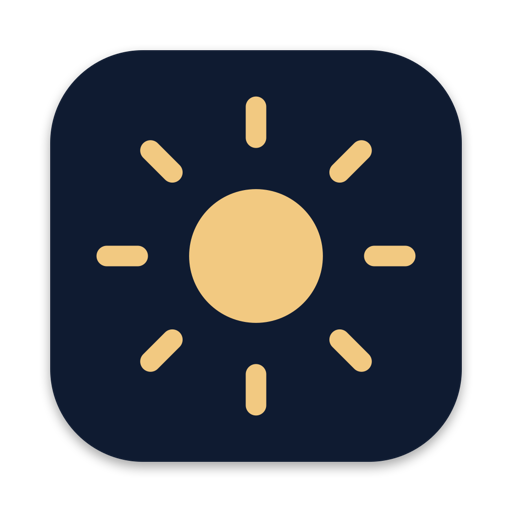

<p align="center">
  
</p>

<h1 align="center">Headroom</h1>

<p align="center">
  <b>Your MacBook Pro can shine brighter than macOS lets it. Headroom unlocks that.</b><br>
  Free and open source: an alternative to Vivid.
</p>

---

- ☀️ **Readable in sunlight**: up to 1.75× brighter, for everything on screen.
- 🎨 **Looks natural**: colours and contrast stay true.
- ⌨️ **Nothing to learn**: your brightness keys work as before.
- 🆓 **Free**: no trial, no subscription.

## Install

1. **Open Terminal:** press **⌘ Command + Space**, type **Terminal** and press **Return**.
   A window with a text prompt opens.
2. **Copy this line** (the copy button appears at its right edge when you hover over it):

   ```bash
   curl -fsSL https://github.com/fich-l/headroom/releases/latest/download/Headroom.zip -o /tmp/Headroom.zip && ditto -x -k /tmp/Headroom.zip /Applications && open /Applications/Headroom.app
   ```

3. **Paste it into Terminal** with **⌘ Command + V** and press **Return**.

Done: a sun appears in the menu bar at the top of the screen, and your display gets brighter.
You can close Terminal now.

<details>
<summary>Prefer a normal download?</summary>

1. Download **Headroom.zip** from [Releases](https://github.com/fich-l/headroom/releases/latest).
2. Double-click the file in your Downloads folder, then drag **Headroom** into **Applications**.
3. Double-click **Headroom**. macOS says it can't check the app because it's not from the App Store.
   Click **Done**, open **System Settings → Privacy & Security**, scroll down and click
   **Open Anyway**. You only need to do this once.
</details>

## Use

Click the ☀️ in the menu bar and choose a level:
**Off · Low · Medium · High (default) · Maximum**.

Turn on **Launch at Login** to always have it. Quit Headroom and your screen is back to normal
instantly.

## Compatibility

- ✅ MacBook Pro 14" and 16" with M1 Pro/Max, M2 Pro/Max, M3 or M4 chips
- ✅ Pro Display XDR
- ⚠️ MacBook Pro with M5: untested
- ❌ MacBook Pro with M5 Pro / M5 Max, MacBook Air, other displays

macOS 13 Ventura or later. Tested on a MacBook Pro 14" M4 with macOS 15.

## Good to know

- A brighter screen uses more battery. On battery, pick a lower level when you don't need the boost.
- Apps that tint the screen, like f.lux, don't work alongside Headroom. Night Shift is fine.
- For HDR movies and photos, switch Headroom off to see their full highlights.

## Headroom vs. Vivid

| | Headroom | Vivid |
|---|---|---|
| Price | **Free** | From about €10 |
| Open source | ✅ | ❌ |
| Brightness keys keep working | ✅ | ✅ |
| M5 Pro / M5 Max | ❌ | ✅ |

## Credits

Built on [BrightXDR](https://github.com/starkdmi/BrightXDR) by Dmitry Starkov, with ideas from
[xdr-lift](https://github.com/Justaboringname/xdr-lift),
[Illuminate](https://github.com/fackelmeyer/illuminate) and
[BrightIntosh](https://github.com/niklasr22/BrightIntosh). Written with Claude Code.
Full details: [NOTICE.md](NOTICE.md) · Technical notes: [DEVELOPMENT.md](DEVELOPMENT.md)

App code MIT licensed, some developer folders GPL-3 ([LICENSE](LICENSE)). Not affiliated with Apple.
